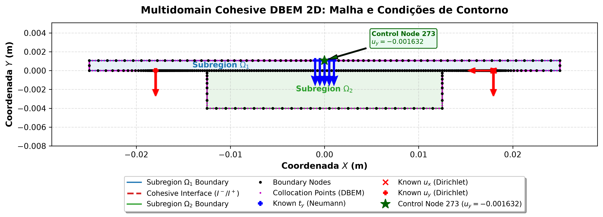
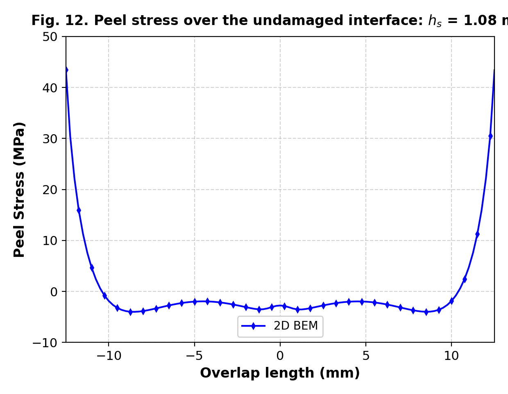
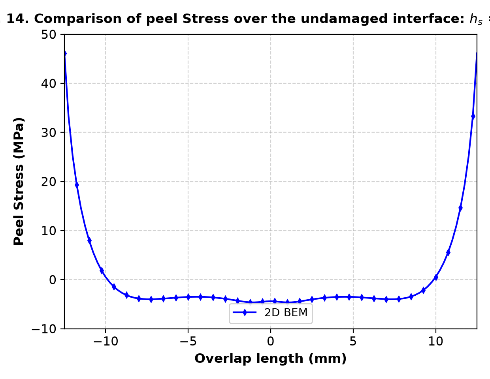
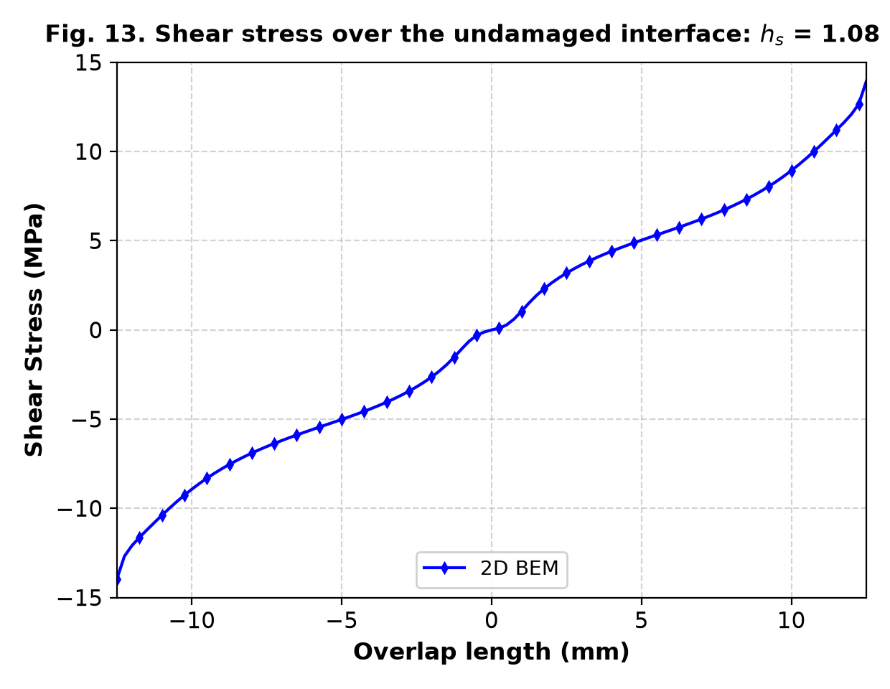
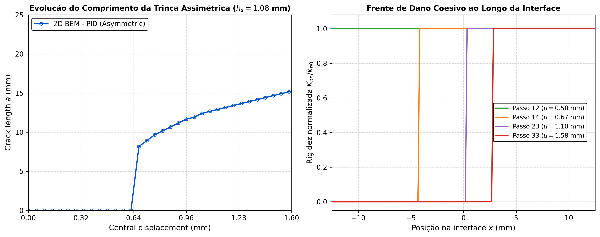

# Multizone Cohesive DBEM 2D — Análise de Descolamento em Juntas Coladas (`COHESIVE_DBEM_2D`)

Código computacional em **Fortran moderno (`OpenMP Multithread + LAPACK/BLAS`)** com pipeline completo de pré e pós-processamento em **Python (`Gmsh + meshio + matplotlib`)** para modelagem elástica linear e simulação não linear de propagação de dano coesivo (*Progressive Interface Damage* — PID) em juntas adesivas e estruturas multidomínio bidimensionais via **Método dos Elementos de Contorno Dual (Multizone Cohesive DBEM 2D)**.

Este repositório reproduz os benchmarks numéricos do artigo científico:

> **Comparative analysis of adhesive debonding in three-point bending tests using boundary element methods: Coupled criterion versus interface damage model**  
> *Sérgio Gustavo Ferreira Cordeiro, Thiago V. Birro, René Quispe Rodriguez, Eder Lima de Albuquerque, Lucas Silveira Campos, Jairo Francisco Useche Vivero, Éric Paroissien, Maëlenn Aufray, Frédéric Lachaud.*  
> **Engineering Analysis with Boundary Elements (EABE)**, vol. 180, 106474, 2025.  
> Artigo no repositório: [`ArtigoEABE2025.pdf`](ArtigoEABE2025.pdf)

---

## 1. Estrutura do Repositório

```text
.
├── ArtigoEABE2025.pdf                                   # Artigo de referência (EABE 2025)
├── requirements.txt                                     # Dependências Python do projeto
└── COHESIVE_DBEM_2D_14_03/                              # Diretório principal do solver e scripts
    ├── MAIN_COHESIVE_DBEM_2D.f90                        # Programa principal Fortran (OpenMP)
    ├── MODULE_DATA.f90                                  # Variáveis globais e estruturas de dados
    ├── MODULE_INPUT_DATA.f90                            # Leitura de arquivos .txt e quadratura de Gauss
    ├── MODULE_DATA_TREATMENT.f90                        # Pontos de colocação e pareamento coesivo I-/I+
    ├── MODULE_GEOMETRIC_MAPPINGS.f90                    # Jacobiano, vetor normal e interpolação
    ├── MODULE_APPROXIMATION_FUNCTIONS.f90               # Funções de forma descontínuas e derivadas
    ├── MODULE_NUMERICAL_INTEGRATION.f90                 # Integração regular e singular (CPV / HFP)
    ├── MODULE_ANALYSIS.f90                              # Montagem paralela OpenMP das matrizes H e G
    ├── MODULE_SOLVER.f90                                # Solver linear (DGESV) e Newton-Raphson (DGETRF/DGETRS)
    ├── MODULE_POSTPROCESSING.f90                        # Pós-processamento de contorno, tensões e VTK
    ├── makefile                                         # Script de compilação gfortran (-O3 -fopenmp)
    ├── gmsh_to_dbem.py                                  # Pré-processador Gmsh (.geo -> .msh) -> 5 arquivos .txt
    ├── plot_mesh_bc.py                                  # Visualização da malha e condições de contorno
    ├── animate_debonding.py                             # Gerador de animação .mp4 sincronizada (Malha + Fig. 26)
    ├── Run_cohesive_dbem_2d.ipynb                       # Notebook 1: Análise Elástica Linear (Figs. 10, 12–15)
    ├── Run_cohesive_dbem_2d_on_Colab.ipynb              # Notebook 2: Análise Linear otimizada para Google Colab
    ├── Run_cohesive_dbem_2d_nlinear.ipynb               # Notebook 3: Análise Não Linear PID Passo a Passo (Fig. 26)
    ├── debonding_animation_hs108.mp4                    # Vídeo MP4 do descolamento assimétrico sincronizado
    └── sim_fig26_nlinear/                               # Arquivos de entrada e saída da análise não linear (Fig. 26)
```

---

## 2. Destaques e Resultados Reproduzidos

### 2.1 Malha de Elementos de Contorno e Condições de Contorno (Fig. 10)
Modelagem multidomínio do ensaio de flexão em três pontos (*Three-Point Bending Test* — 3PBT, norma ISO 14679-1997) com substrato de Alumínio 2024-T3 ($\Omega_1$, $L_s = 50\text{ mm}$, $h_s = 1.08\text{ mm}$ ou $1.62\text{ mm}$) e bloco de adesivo epóxi DGEBA/DETA ($\Omega_2$, $L_a = 25\text{ mm}$, $h_a = 4.0\text{ mm}$):



### 2.2 Tensões de Descolamento (*Peel*) e Cisalhamento (*Shear*) na Interface Íntegra (Figs. 12 a 15)
Obtidas com a análise elástica linear (`ANALYSIS_TYPE = 'LE'`) nos notebooks [`Run_cohesive_dbem_2d.ipynb`](COHESIVE_DBEM_2D_14_03/Run_cohesive_dbem_2d.ipynb) e [`Run_cohesive_dbem_2d_on_Colab.ipynb`](COHESIVE_DBEM_2D_14_03/Run_cohesive_dbem_2d_on_Colab.ipynb):

| $h_s = 1.08\text{ mm}$ ($U_c = 0.576\text{ mm}$) | $h_s = 1.62\text{ mm}$ ($U_c = 0.6093\text{ mm}$) |
| :---: | :---: |
|  |  |
|  |  |

### 2.3 Análise Não Linear de Dano Progressivo na Interface — PID (Fig. 26 e Fig. 30)
Detalhada passo a passo no notebook [`Run_cohesive_dbem_2d_nlinear.ipynb`](COHESIVE_DBEM_2D_14_03/Run_cohesive_dbem_2d_nlinear.ipynb), utilizando controle de deslocamento com preditor-corretor de Newton-Raphson e lei de tração-separação bilinear em Modo Misto ($\sigma_c = 44.654\text{ MPa}$, $\mathcal{G}_c = 0.520\text{ N/mm}$, $k_{n0} = k_{t0} = 2000\text{ MPa/mm}$) para descolamento assimétrico (`ANALYSIS_TYPE = 'CA'`):




- **Animação Sincronizada (`.mp4`)**: O script [`animate_debonding.py`](COHESIVE_DBEM_2D_14_03/animate_debonding.py) gera o vídeo [`debonding_animation_hs108.mp4`](COHESIVE_DBEM_2D_14_03/debonding_animation_hs108.mp4) mostrando a malha DBEM 2D se deformando em escala $1:1$ (análoga à **Fig. 28** do artigo) em perfeita sincronia com a evolução da curva Força × Deslocamento Central (**Fig. 26**).

---

## 3. Como Compilar e Executar

### 3.1 Requisitos
- **Compilador Fortran**: `gfortran` com suporte a **OpenMP** e bibliotecas **LAPACK / BLAS**;
- **Gerador de Malha**: **Gmsh** (executável de sistema ou pacote `gmsh` via `pip`);
- **Ambiente Python 3.9+**:
  ```bash
  pip install -r requirements.txt
  ```

### 3.2 No Linux / Google Colab
```bash
sudo apt-get update && sudo apt-get install -y gfortran liblapack-dev libblas-dev gmsh
pip install -r requirements.txt
cd COHESIVE_DBEM_2D_14_03
make clean && make
./MAIN_COHESIVE_DBEM_2D
```

### 3.3 No Windows (MSYS2 MinGW-w64 UCRT64)
```powershell
$env:PATH = "C:\msys64\ucrt64\bin;C:\msys64\usr\bin;" + $env:PATH
pip install -r requirements.txt
cd COHESIVE_DBEM_2D_14_03
mingw32-make clean
mingw32-make
.\MAIN_COHESIVE_DBEM_2D.exe
```

### 3.4 Gerando a Animação `.mp4` do Descolamento
```bash
python COHESIVE_DBEM_2D_14_03/animate_debonding.py
```

Para mais detalhes sobre a formulação matemática e arquitetura modular do solver Fortran, consulte [`COHESIVE_DBEM_2D_14_03/README.md`](COHESIVE_DBEM_2D_14_03/README.md).
