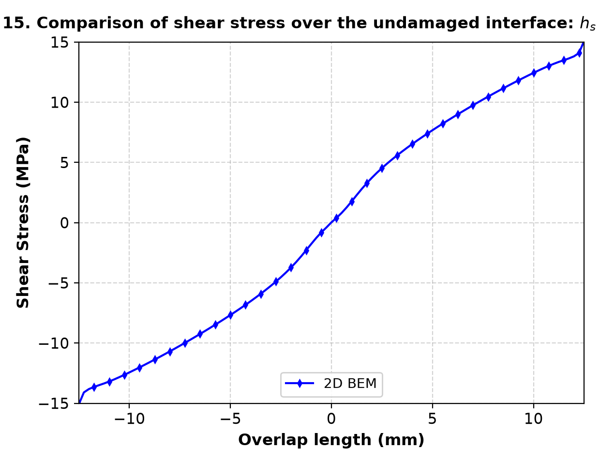
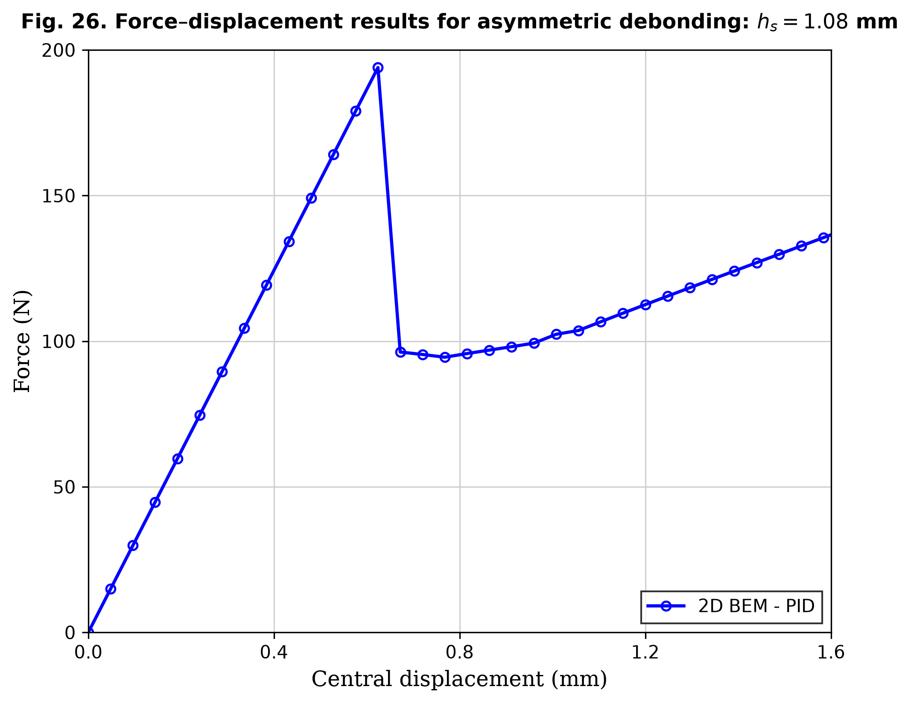

# Multizone Cohesive DBEM 2D — Adhesive Joint Debonding Analysis (`COHESIVE_DBEM_2D`)

Modern **Fortran (`OpenMP Multithread + LAPACK/BLAS`)** solver with a complete **Python (`Gmsh + meshio + matplotlib`)** preprocessing and postprocessing pipeline for linear elastic modeling and nonlinear progressive interface damage (PID) simulation of adhesively bonded joints and 2D multidomain structures using the **Multizone Cohesive Dual Boundary Element Method (DBEM 2D)**.

This repository reproduces the numerical benchmarks presented in the following scientific paper:

> **Comparative analysis of adhesive debonding in three-point bending tests using boundary element methods: Coupled criterion versus interface damage model**  
> *Sérgio Gustavo Ferreira Cordeiro, Thiago V. Birro, René Quispe Rodriguez, Eder Lima de Albuquerque, Lucas Silveira Campos, Jairo Francisco Useche Vivero, Éric Paroissien, Maëlenn Aufray, Frédéric Lachaud.*  
> **Engineering Analysis with Boundary Elements (EABE)**, vol. 180, 106474, 2025.  
> Reference paper in repository: [`ArtigoEABE2025.pdf`](ArtigoEABE2025.pdf)

---

## 1. Repository Structure

```text
.
├── ArtigoEABE2025.pdf                                   # Reference paper (EABE 2025)
├── requirements.txt                                     # Python dependencies
└── COHESIVE_DBEM_2D_14_03/                              # Main solver and scripts directory
    ├── MAIN_COHESIVE_DBEM_2D.f90                        # Main Fortran program (OpenMP)
    ├── MODULE_DATA.f90                                  # Global variables and data structures
    ├── MODULE_INPUT_DATA.f90                            # .txt input file parser and Gauss quadrature
    ├── MODULE_DATA_TREATMENT.f90                        # Collocation points and I-/I+ cohesive node pairing
    ├── MODULE_GEOMETRIC_MAPPINGS.f90                    # Jacobian, outward normal vector, and interpolation
    ├── MODULE_APPROXIMATION_FUNCTIONS.f90               # Discontinuous shape functions and derivatives
    ├── MODULE_NUMERICAL_INTEGRATION.f90                 # Regular and singular integration (CPV / HFP)
    ├── MODULE_ANALYSIS.f90                              # OpenMP-parallelized H and G matrix assembly
    ├── MODULE_SOLVER.f90                                # Linear (DGESV) and Newton-Raphson (DGETRF/DGETRS) solvers
    ├── MODULE_POSTPROCESSING.f90                        # Boundary/internal stresses, displacements, and VTK output
    ├── makefile                                         # gfortran build script (-O3 -fopenmp)
    ├── gmsh_to_dbem.py                                  # Gmsh preprocessor (.geo -> .msh) -> 5 Fortran .txt files
    ├── plot_mesh_bc.py                                  # Mesh and boundary condition visualizer
    ├── animate_debonding.py                             # Synchronized .mp4 animation generator (Mesh + Fig. 26)
    ├── Run_cohesive_dbem_2d.ipynb                       # Notebook 1: Linear Elastic Analysis (Figs. 10, 12–15)
    ├── Run_cohesive_dbem_2d_on_Colab.ipynb              # Notebook 2: Linear Analysis tailored for Google Colab
    ├── Run_cohesive_dbem_2d_nlinear.ipynb               # Notebook 3: Step-by-Step Nonlinear PID Analysis (Fig. 26)
    ├── debonding_animation_hs108.mp4                    # Synchronized MP4 animation of asymmetric debonding
    └── sim_fig26_nlinear/                               # Input and output files for nonlinear analysis (Fig. 26)
```

---

## 2. Highlights and Reproduced Results

### 2.1 Boundary Element Mesh and Boundary Conditions (Fig. 10)
Multidomain modeling of the Three-Point Bending Test (3PBT, ISO 14679-1997 standard) consisting of an Aluminum 2024-T3 substrate ($\Omega_1$, $L_s = 50\text{ mm}$, $h_s = 1.08\text{ mm}$ or $1.62\text{ mm}$) bonded to a DGEBA/DETA epoxy adhesive block ($\Omega_2$, $L_a = 25\text{ mm}$, $h_a = 4.0\text{ mm}$):


### 2.2 Peel and Shear Stresses Along the Undamaged Interface (Figs. 12–15)
Computed via linear elastic analysis (`ANALYSIS_TYPE = 'LE'`) in [`Run_cohesive_dbem_2d.ipynb`](COHESIVE_DBEM_2D_14_03/Run_cohesive_dbem_2d.ipynb) and [`Run_cohesive_dbem_2d_on_Colab.ipynb`](COHESIVE_DBEM_2D_14_03/Run_cohesive_dbem_2d_on_Colab.ipynb):

| $h_s = 1.08\text{ mm}$ ($U_c = 0.576\text{ mm}$) | $h_s = 1.62\text{ mm}$ ($U_c = 0.6093\text{ mm}$) |
| :---: | :---: |
|  |  |
|  |  |

### 2.3 Nonlinear Progressive Interface Damage Analysis — PID (Fig. 26 and Fig. 30)
Detailed step by step in [`Run_cohesive_dbem_2d_nlinear.ipynb`](COHESIVE_DBEM_2D_14_03/Run_cohesive_dbem_2d_nlinear.ipynb), employing displacement-controlled Newton-Raphson continuation with a mixed-mode bilinear traction-separation law ($\sigma_c = 44.654\text{ MPa}$, $\mathcal{G}_c = 0.520\text{ N/mm}$, $k_{n0} = k_{t0} = 2000\text{ MPa/mm}$) for asymmetric debonding (`ANALYSIS_TYPE = 'CA'`):




- **Synchronized Animation (`.mp4`)**: The script [`animate_debonding.py`](COHESIVE_DBEM_2D_14_03/animate_debonding.py) generates [`debonding_animation_hs108.mp4`](COHESIVE_DBEM_2D_14_03/debonding_animation_hs108.mp4), displaying the 2D DBEM mesh deforming on a true $1:1$ scale (analogous to **Fig. 28** of the paper) synchronized frame by frame with the Force vs. Central Displacement curve (**Fig. 26**).

---

## 3. Build and Run Instructions

### 3.1 Prerequisites
- **Fortran Compiler**: `gfortran` with **OpenMP** support and **LAPACK / BLAS** libraries;
- **Mesh Generator**: **Gmsh** (system executable or `gmsh` Python package via `pip`);
- **Python 3.9+ Environment**:
  ```bash
  pip install -r requirements.txt
  ```

### 3.2 Linux / Google Colab
```bash
sudo apt-get update && sudo apt-get install -y gfortran liblapack-dev libblas-dev gmsh
pip install -r requirements.txt
cd COHESIVE_DBEM_2D_14_03
make clean && make
./MAIN_COHESIVE_DBEM_2D
```

### 3.3 Windows (MSYS2 MinGW-w64 UCRT64)
```powershell
$env:PATH = "C:\msys64\ucrt64\bin;C:\msys64\usr\bin;" + $env:PATH
pip install -r requirements.txt
cd COHESIVE_DBEM_2D_14_03
mingw32-make clean
mingw32-make
.\MAIN_COHESIVE_DBEM_2D.exe
```

### 3.4 Generating the Debonding `.mp4` Animation
```bash
python COHESIVE_DBEM_2D_14_03/animate_debonding.py
```

For further details on the mathematical formulation, OpenMP optimizations, and modular solver architecture, see [`COHESIVE_DBEM_2D_14_03/README.md`](COHESIVE_DBEM_2D_14_03/README.md).
